# Real-Time Data Pipeline on AWS: Kinesis → Lambda → DynamoDB

A serverless, event-driven pipeline that ingests JSON records into **Amazon Kinesis Data Streams**, processes them with **AWS Lambda**, and stores them in **Amazon DynamoDB** for persistent storage and querying. Everything was built and tested by hand in the AWS Management Console.


## Table of contents
- [Overview](#overview)
- [Architecture](#architecture)
- [Tech stack](#tech-stack)
- [What I built](#what-i-built)
- [Step-by-step implementation](#step-by-step-implementation)
- [Results](#results)
- [Repository structure](#repository-structure)
- [Key learnings](#key-learnings)
- [Possible improvements](#possible-improvements)

## Overview

**Problem.** Build a real-time pipeline where data is written to a Kinesis stream and automatically copied into a DynamoDB database for persistent storage and retrieval.

**Scenario.** *TELEMAX*, a telecommunications company building networks in fast-growing, underserved markets, needs a NoSQL data-warehousing architecture on AWS that can absorb high-volume, real-time data streams from its network operations.

**Objective.** Deploy the infrastructure for real-time data management on AWS, with seamless streaming and storage.

## Architecture

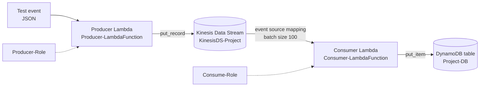

1. The **Producer Lambda** receives an event, serialises it to JSON and publishes it to Kinesis with a random UUID partition key.
2. **Kinesis** buffers the record and triggers the Consumer through an event source mapping.
3. The **Consumer Lambda** base64-decodes each record, parses the JSON and writes it to DynamoDB.
4. **DynamoDB** stores each record, keyed by `id`, ready to scan or filter.

## Tech stack

| Service | Role in the project |
|---|---|
| Amazon Kinesis Data Streams | Real-time ingestion (on-demand capacity mode) |
| AWS Lambda (Python, boto3) | Producer and Consumer functions |
| Amazon DynamoDB | NoSQL storage, partition key `id` (String), on-demand capacity |
| AWS IAM | Separate execution roles for Producer and Consumer |
| AWS Management Console | Provisioning, testing and verification |

Region: `us-east-1` (N. Virginia).

## What I built

- A Kinesis data stream (`KinesisDS-Project`) in on-demand mode.
- Two IAM roles: `Producer-Role` and `Consume-Role`, each assumable by the Lambda service.
- A **Producer** Lambda that writes records to the stream.
- A **Consumer** Lambda triggered automatically by the stream that persists each record to DynamoDB.
- A DynamoDB table (`Project-DB`) with `id` as the partition key.
- End-to-end tests with different payloads, verified with DynamoDB **Scan** and **filter by attribute**.

## Step-by-step implementation

### Step 1: Create the Kinesis data stream
In the Kinesis console, create a data stream named `KinesisDS-Project` using **On-demand** capacity mode, so throughput scales automatically.

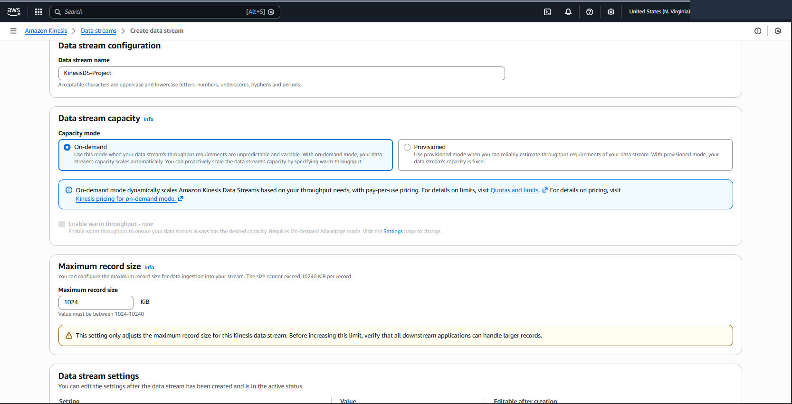

### Step 2: Create the IAM role for the Producer
In IAM, create `Producer-Role` with Lambda as the trusted entity and attach:
- `AmazonKinesisFullAccess`
- `AWSLambdaKinesisExecutionRole`

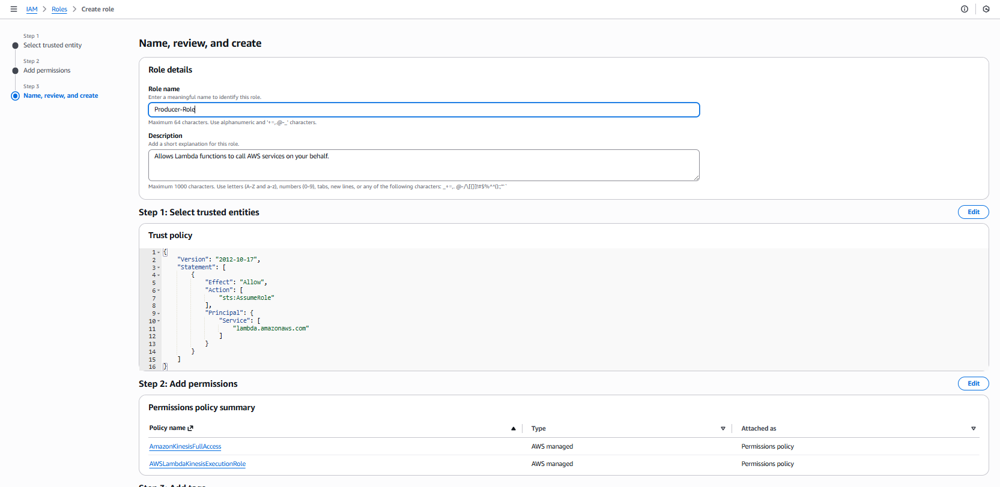

### Step 3: Create the IAM role for the Consumer
Create `Consume-Role` for the Consumer function. It needs to read from Kinesis and write to DynamoDB, so attach:
- `AmazonKinesisFullAccess`
- `AWSLambdaKinesisExecutionRole`
- `AmazonDynamoDBFullAccess`

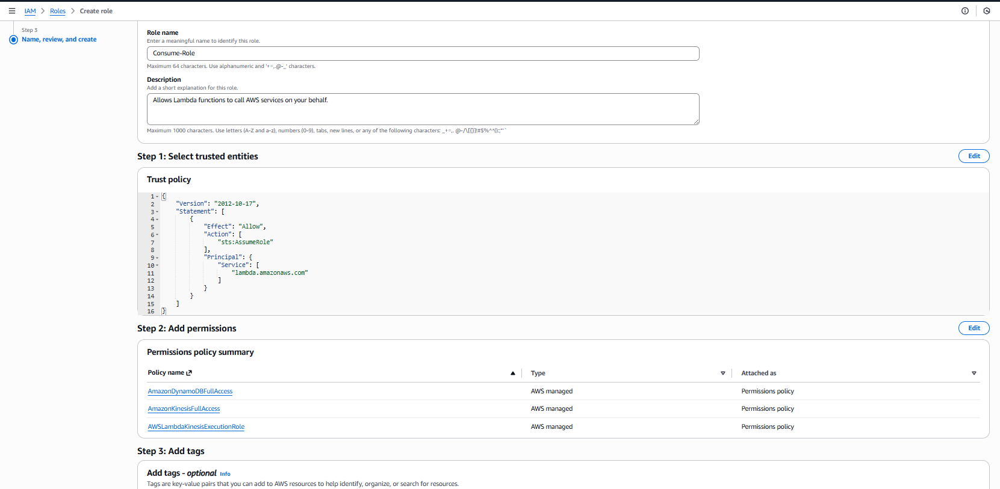

### Step 4: Verify the IAM roles
Confirm both roles exist and that their trust policy lets `lambda.amazonaws.com` assume them.

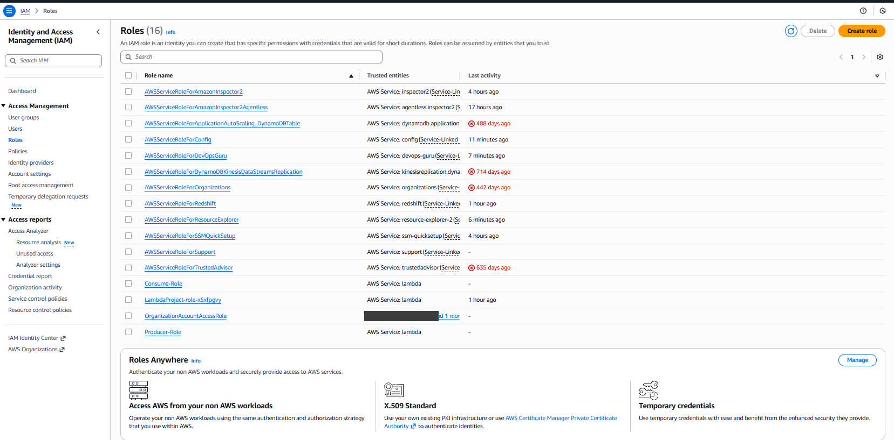

### Step 5: Open the Lambda service
Go to AWS Lambda to create two separate functions: one to write to Kinesis, one to read from it.

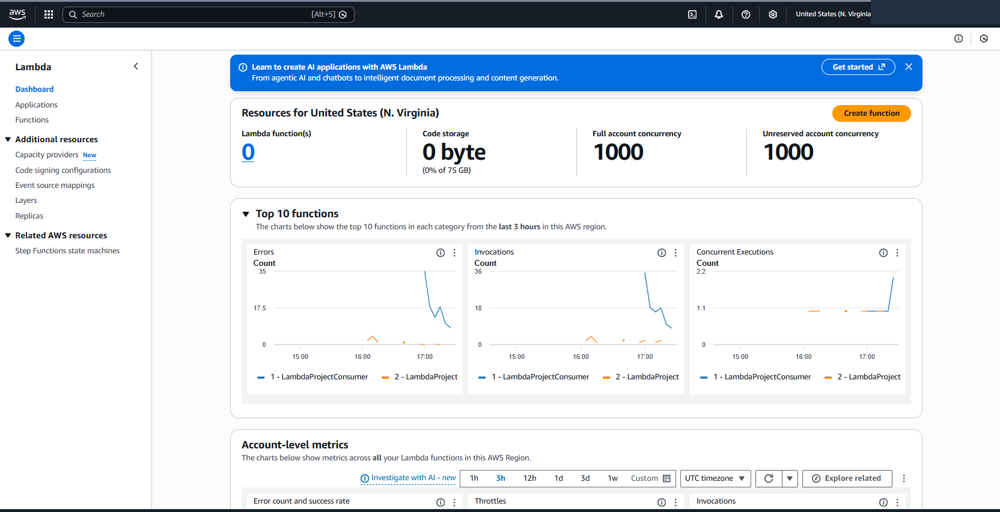

### Step 6: Create the Producer Lambda function
Create `Producer-LambdaFunction` (author from scratch, Python) and attach `Producer-Role` as its execution role.

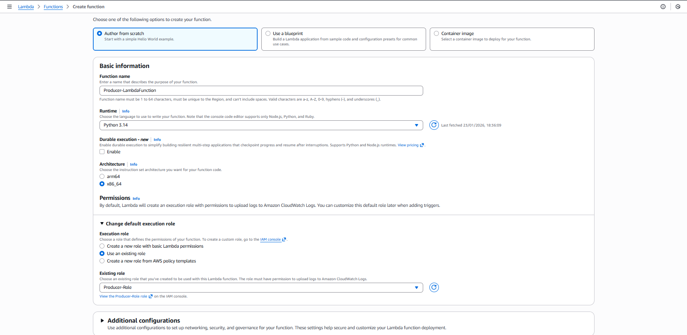

### Step 7: Deploy the Producer code
The function turns the incoming event into JSON and publishes it to the stream with a unique partition key. Full file: [`src/producer_lambda.py`](src/producer_lambda.py).

```python
import json
import boto3
import uuid


def lambda_handler(event, context):
    client = boto3.client('kinesis')

    response = client.put_record(
        StreamName='KinesisDS-Project',
        Data=json.dumps(event),
        PartitionKey=str(uuid.uuid4())
    )

    print(response)
    return response
```

A random UUID partition key spreads records evenly across shards.

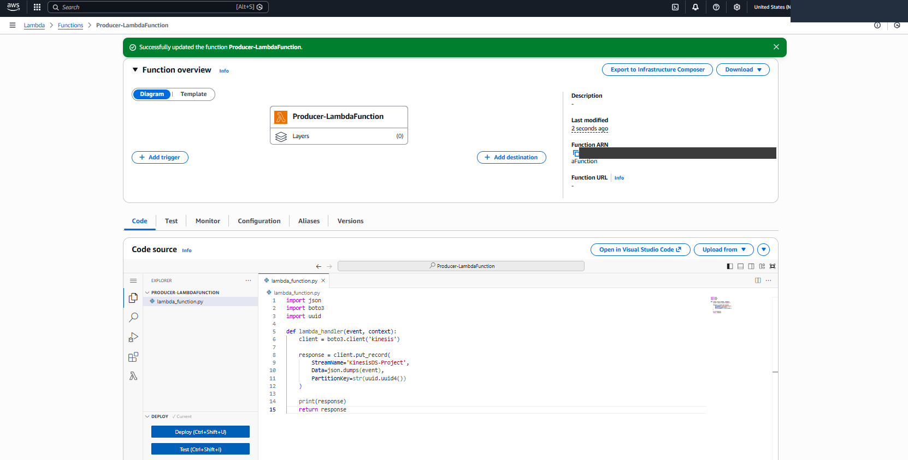

### Step 8: Create a test event
In the Lambda **Test** tab, create an event (for example `ProducerEvent`) with the payload from [`events/sample_event.json`](events/sample_event.json):

```json
{
  "id": "b2bfe236-c738-4916-9015-ce47d49d1235",
  "canFly": true,
  "name": "Abid AGha",
  "colors": ["black", "white", "blue", "grey"]
}
```

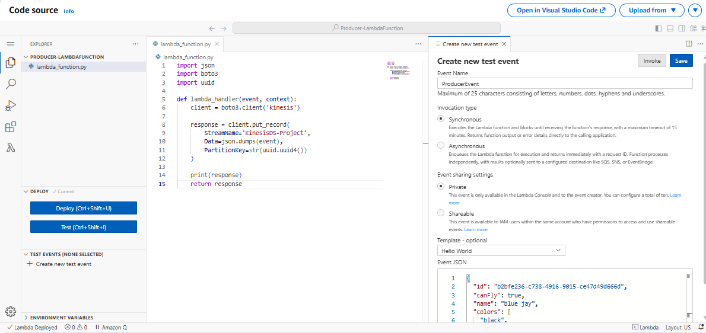

### Step 9: Run the Producer test
Run the test and check the execution result: a successful status and a Kinesis response containing a `ShardId` and `SequenceNumber`, meaning the record reached the stream.

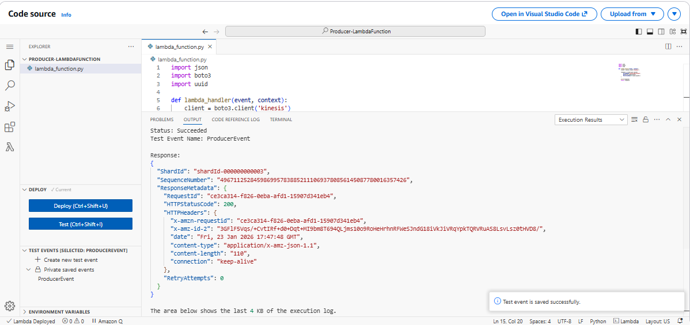

### Step 10: Create the Consumer Lambda function
Create `Consumer-LambdaFunction` and attach `Consume-Role` as its execution role.

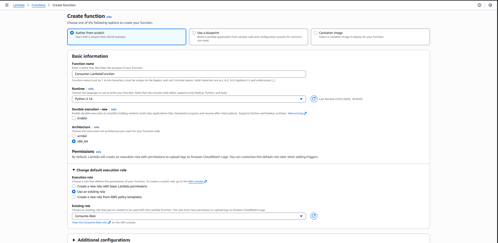

### Step 11: Create the DynamoDB table
Create the table `Project-DB` with partition key `id` (String), using default settings (on-demand capacity).

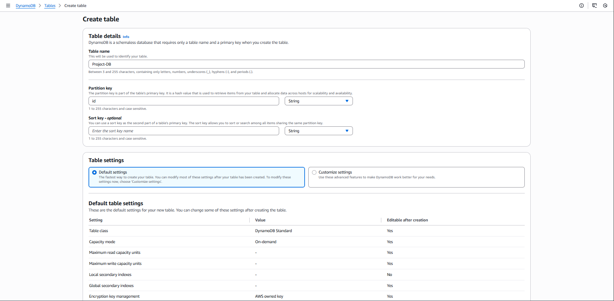

### Step 12: Deploy the Consumer code
The Consumer decodes each Kinesis record (base64), parses the JSON and writes it to DynamoDB. Full file: [`src/consumer_lambda.py`](src/consumer_lambda.py).

```python
import base64
import json
import boto3


def lambda_handler(event, context):

    for record in event['Records']:
        payload = base64.b64decode(record["kinesis"]["data"])
        res = json.loads(payload)

        write_to_db(res)
        print("Object successfully stored in DB.")

    return "Success"


def write_to_db(data):
    dynamodb = boto3.resource('dynamodb', region_name="us-east-1")
    table = dynamodb.Table("Project-DB")

    table.put_item(Item=data)
```

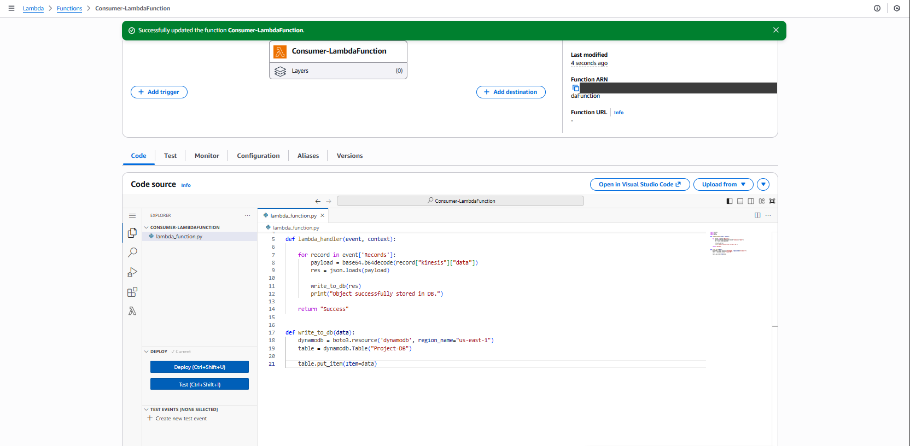

### Step 13: Add the Kinesis trigger
On the Consumer function, **Add trigger** → **Kinesis** → select `KinesisDS-Project`. Settings used: trigger activated, **batch size 100**, **starting position: Latest**. Lambda now runs automatically whenever new records arrive.

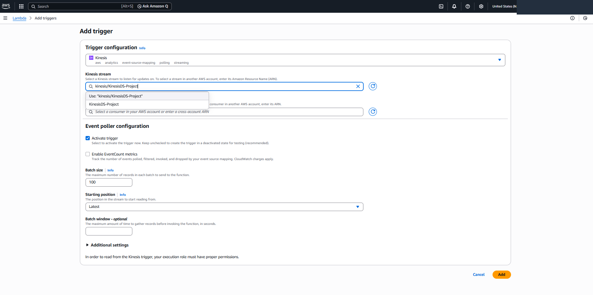

AWS confirms the trigger was added:

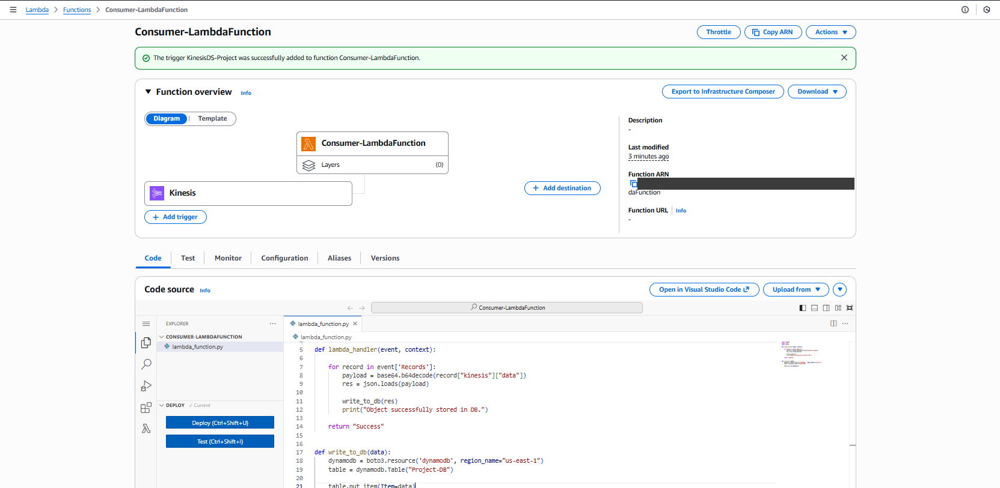

### Step 14: Check DynamoDB
Open `Project-DB` → **Explore items** to see the records written by the Consumer.

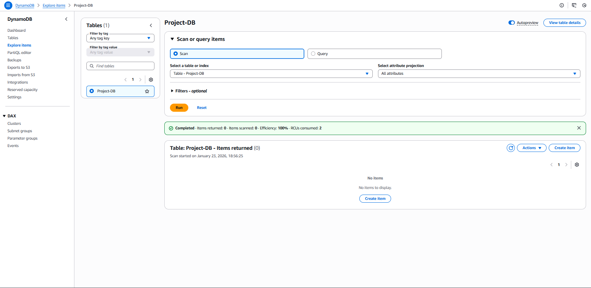

### Step 15: Test with modified data
Back in the Producer, change the last four characters of the `id` in the test event, save, and run the test again.

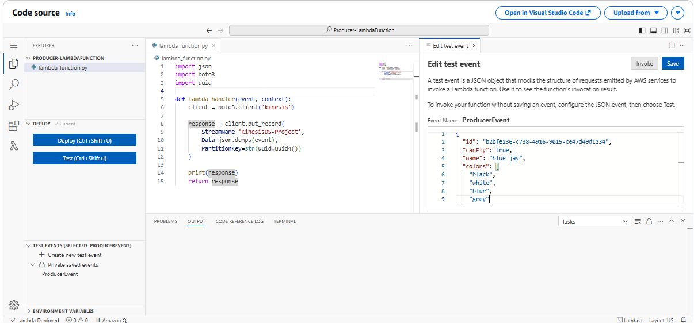

### Step 16: Scan the table
In DynamoDB run **Scan** and confirm the new record was added alongside the first.

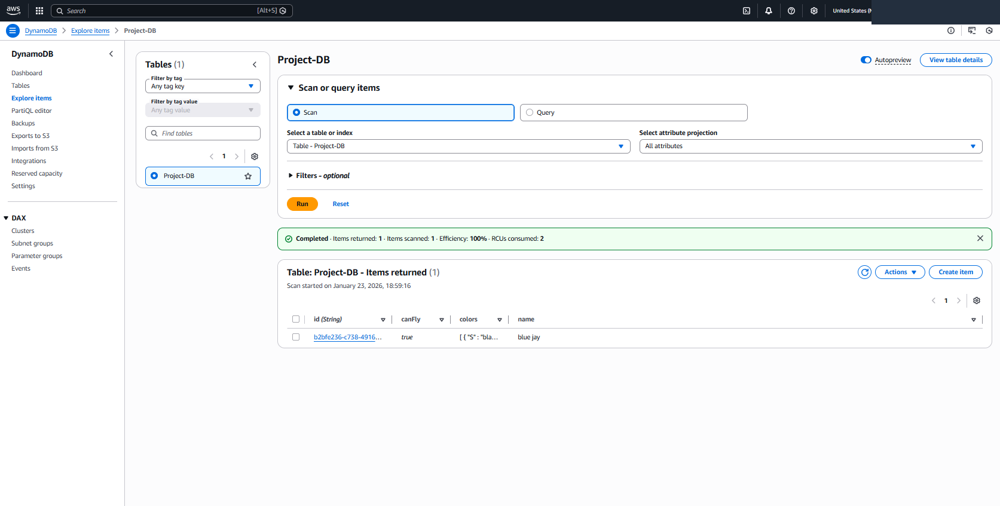

### Step 17: Test with several changed fields
Change both `id` and `name` in the test event and run it again to show the pipeline handles different payloads.

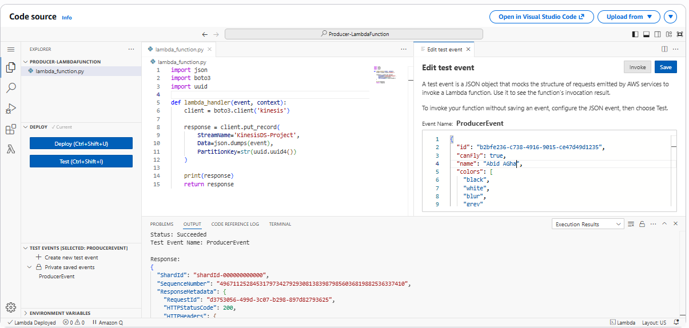

### Step 18: Filter by attribute
Confirm the new record appears and filter the items by the `name` attribute to show DynamoDB's retrieval capabilities.

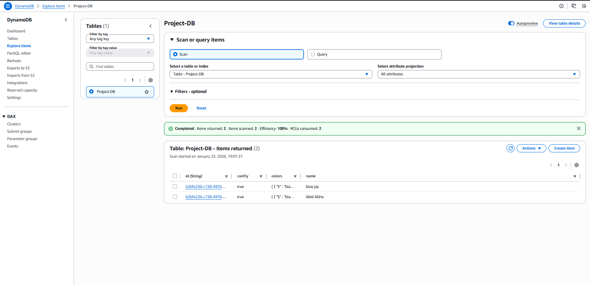

## Results

- Records sent through the Producer Lambda appeared in DynamoDB without any manual step, confirming the **end-to-end flow** from ingestion to persistent storage.
- Multiple records with different `id` and `name` values were stored as separate items.
- Items could be listed with **Scan** and narrowed with attribute **filters**.

## Repository structure

```
.
├── README.md
├── src/
│   ├── producer_lambda.py     # writes events to Kinesis
│   └── consumer_lambda.py     # Kinesis → DynamoDB
├── events/
│   └── sample_event.json      # test payload for the Producer
└── images/                    # console screenshots, numbered by step
```

## Key learnings

- Designing a producer/consumer pattern with Kinesis Data Streams and event source mappings.
- Writing Python Lambda functions with `boto3`, including decoding base64 Kinesis payloads.
- Creating separate IAM execution roles per function and understanding Lambda trust relationships.
- Modelling a simple DynamoDB table (partition key) and querying it with Scan and filters.

## Possible improvements

- **Least-privilege IAM.** This project used AWS managed `*FullAccess` policies for speed. For production, scope the roles to the specific stream and table ARNs.
- **Infrastructure as Code.** Recreate the setup with AWS SAM, CloudFormation or Terraform so it is repeatable.
- **Error handling.** Add try/except, a dead-letter queue / on-failure destination, retries and partial-batch responses in the Consumer.
- **Efficiency.** Create the DynamoDB resource outside the handler so it is reused across invocations, and use `batch_writer` for bulk writes.
- **Observability.** Enable CloudWatch alarms and EventCount metrics on the trigger.
- **Data handling.** Add schema validation, and convert floats to `Decimal` before writing to DynamoDB.
- **Extensions.** Real-time analytics, transformation pipelines, or an API Gateway front end for the Producer.
